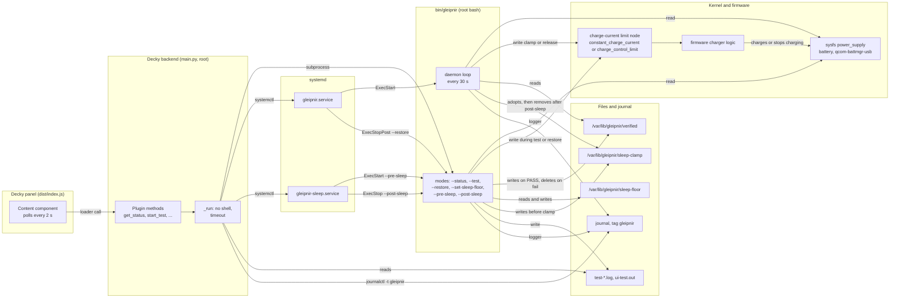
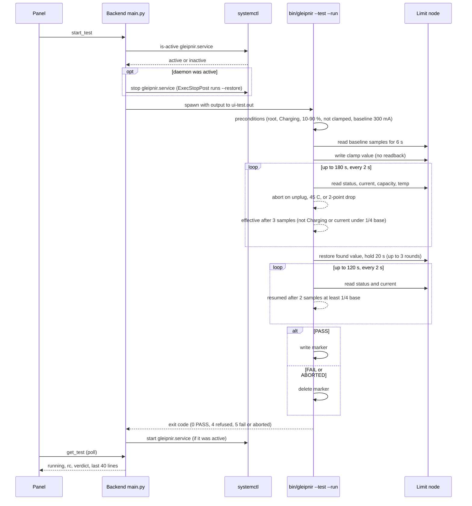
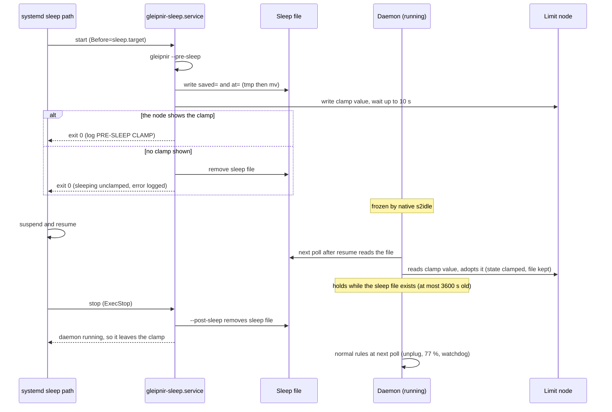

# 03 - Data flow and interfaces

## 1. Data flow

Reading the diagram: the panel never reaches the limit node. Every change to the node goes through the script, which the unit runs, the sleep unit runs, or the backend runs as a subprocess. The arrows labelled "write" are the only writes to the node.

## 2. Sequence: the supervised test

Source for each step: `main.py:188-241`, `bin/gleipnir:274-352`. The "effective" and "resumed" rules are in [02](02-algorithms.md), section 7.

## 3. Sequence: suspend with the daemon running

Sources: `bin/gleipnir:222-254`, `:413-420`, `:440-445`; `systemd/gleipnir-sleep.service`. The freeze and the adoption timing are repo-reported (`docs/evidence.md`, 2026-10-08), not re-observed here. The diagram's last step on resume relies on the systemd ExecStop order, which the repo does not verify in code (**unverified**).

## 4. Interfaces

### 4.1 Sysfs nodes read
| Path (under `/sys/class/power_supply`) | Used for | Source |
|---|---|---|
| `battery/capacity` | Charge percent | `bin/gleipnir:94`, `:400` |
| `battery/status` | `Charging`, `Discharging`, `Not charging`, ... | `:94`, `:400` |
| `battery/current_now` | Signed current in µA (watchdog uses the sign) | `:94`, `:400`, `:448` |
| `battery/voltage_now` | µV | `:95` |
| `battery/temp` | Tenths of a degree C | `:95` |
| `battery/health` | Health string | `:95` |
| `qcom-battmgr-usb/online` | Charger online, 0 or 1 | `:45`, `:400` |
| Each entry of the power-supply directory | Listed in the test's refusal message | `bin/gleipnir:284` |

### 4.2 Sysfs nodes written
| Path | Values | Source |
|---|---|---|
| `battery/constant_charge_current` | Clamp 0; restored value; node maximum | `:102-103`, `:117` |
| `battery/charge_control_limit` | Clamp 1000; restored value; node maximum | `:100-101`, `:117` |

Writes go through `echo VALUE > NODE 2>/dev/null` (`:117`). A failed write is detected only by the readback in `wait_for`.

### 4.3 Read-only nodes the design does not use
`charge_control_start_threshold`, `charge_control_end_threshold`: not read or written by the code (the repo records they read `0` and the firmware ignores the end threshold, `docs/evidence.md`). The code's only node choices are the two in 4.2.

### 4.4 Files

| File | Format | Written by | Read by |
|---|---|---|---|
| `/var/lib/gleipnir/verified` | `node=`, `value=`, `kernel=`, `verified_at=`, `baseline_uA=` (one per line; `date -Is` for the time) | Test on PASS (`:345`) | `marker_ok` (`:175-187`); `--status`; the daemon; the panel's status (via `--status --json`) |
| `/var/lib/gleipnir/sleep-floor` | One integer, 0 to 101 | `--set-sleep-floor` (`:194`) | `sleep_floor` (`:164-167`) |
| `/var/lib/gleipnir/sleep-clamp` | `saved=<value>` and `at=<epoch>` | `--pre-sleep` (`:230-232`) | Daemon adoption and hold (`:413-419`, `:440-442`) |
| `/var/lib/gleipnir/test-<time>.log` | Free text, the test output | Test, through `tee` (`:293-294`) | The user |
| `/var/lib/gleipnir/ui-test.out` | Free text, the test output | Backend (`main.py:198`) | `get_test` (`main.py:235-241`) |
| `/var/lib/gleipnir/.avg` | One integer | Test (`:300`) | Test (`:313`) |
| `/var/local/bin/gleipnir` | The script | Backend install and sync (`main.py:120-131`) | Unit `ExecStart`; backend |
| `/etc/systemd/system/gleipnir.service`, `gleipnir-sleep.service` | Unit files | Backend install and sync (`main.py:25-26`, `:120-131`) | systemd |

### 4.5 `--status --json` (one line)
The object's keys are listed in the application spec (`03-cli.md`, "--status --json fields"). The backend's `_status_sync` (`main.py:93-114`) adds `installed`, `active`, `enabled`, `daemon` (the parsed object), `error` and `test` (the test state) around it. The panel reads those keys (`dist/index.js:47`, `:93-94`).

### 4.6 Decky RPC methods

| Panel call (`dist/index.js`) | Backend method (`main.py`) | Lines in `main.py` | Returns |
|---|---|---|---|
| `get_status` (`:17`) | `get_status` | `:116` | Status object (4.5) |
| `install` (`:18`) | `install` | `:133` | Status object |
| `uninstall` (`:19`) | `uninstall` | `:166` | Status object |
| `set_enabled` (`:20`) | `set_enabled(enabled)` | `:150` | Status object |
| `start_test` (`:21`) | `start_test` | `:188` | Test state (`running`, `started`, `finished`, `rc`, `verdict`) |
| `cancel_test` (`:22`) | `cancel_test` | `:226` | Test state |
| `get_test` (`:23`) | `get_test` | `:235` | Test state plus `tail` (last 40 lines) |
| `get_log` (`:24`) | `get_log(lines)` | `:243` | `{ok, lines}` |
| `restore_now` (`:25`) | `restore_now` | `:181` | `{ok, output}` |
| `set_sleep_floor` (`:26`) | `set_sleep_floor(value)` | `:177` | Status object |

Note the panel's own handling: `act()` takes a result and sets the status only when the result has an `installed` key (`dist/index.js:75`). `restore_now` results without that key do not replace the status.

### 4.7 Journal
Tag `gleipnir`, written by `logger -t gleipnir -p daemon.<level>` (`bin/gleipnir:88`). In tests, `GLEIPNIR_NO_SYSLOG` sends the line to stderr instead (`:87`). `GLEIPNIR_LOG_FILE` also appends a `[level] message` line to a file (`:89`).

The messages the code produces, by prefix: `started`, `ARMED`, `MONITOR-ONLY`, `CLAMP at N%`, `RELEASE (why)`, `WATCHDOG`, `LATE CLAMP`, `ADOPT`, `PRE-SLEEP CLAMP`, `post-sleep`, `NOT CHARGING with the limit released`, `three failed limit writes`, `heartbeat`, `test:`, `sleep setting changed`. The panel shows the last lines through `get_log`.

### 4.8 Exit codes and status
See `03-cli.md` in the application spec and [04](04-error-handling-os-constraints.md).
